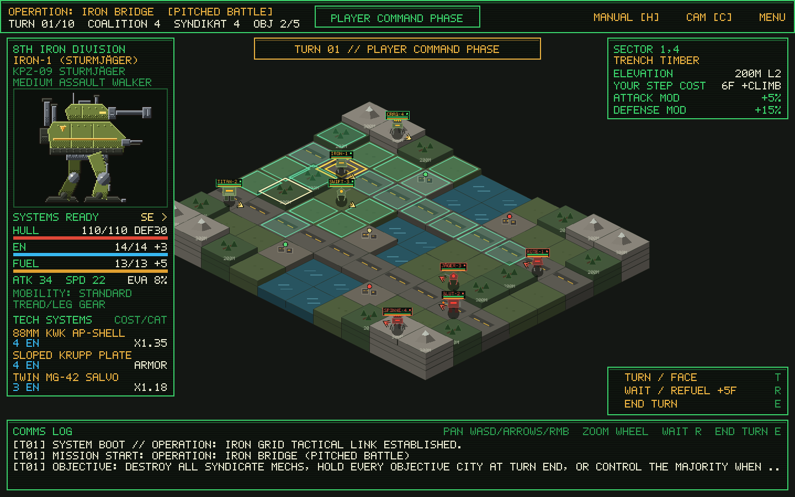
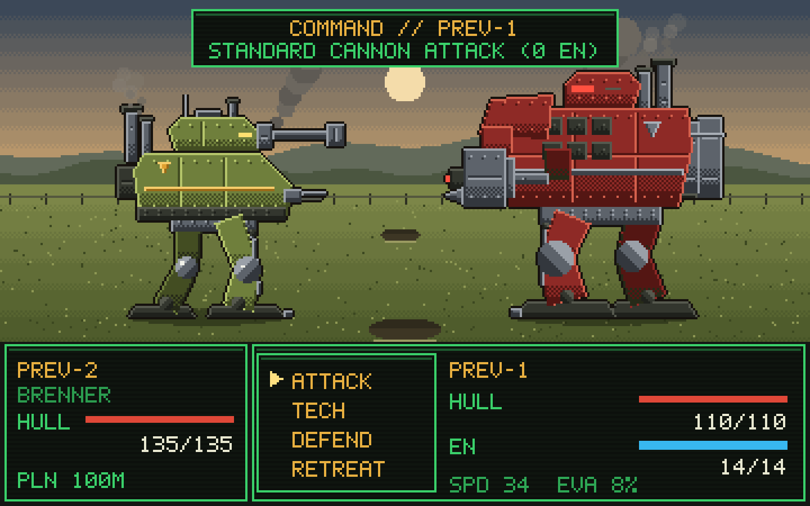
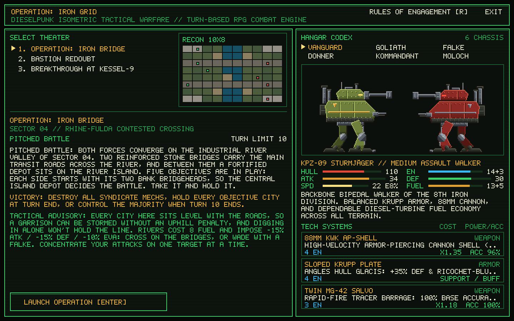
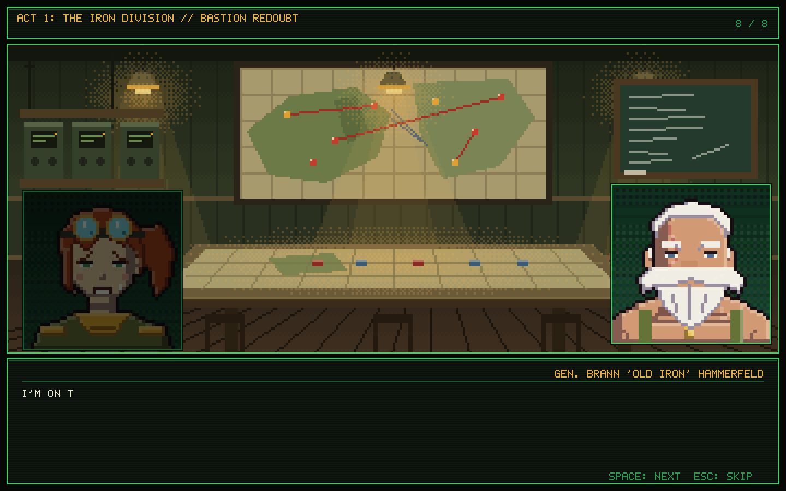

# Operation: Iron Grid

**Operation: Iron Grid** is a dieselpunk isometric turn-based tactical strategy game built in **Godot 4**. Inspired by the heavy mechanical atmosphere of *Ring of Red*, *Steel Battalion*, and *MechWarrior*, the grid-based tactical maneuvering of *Advance Wars* and *Fire Emblem*, and classic *Final Fantasy* turn-based RPG combat encounters.



*Tactical battlefield view: extruded 2.5D isometric terrain, tactical echelon double chevrons, overhead CRT telemetry tags, movement range highlights, Dijkstra fuel path planning, and real-time telemetry HUD.*



*Battle screen: pixel-art walkers with articulated legs, a terrain backdrop chosen by the defender's tile, and the CRT interactive command HUD.*



*Command HQ briefing console: 3 selectable battle theaters, satellite reconnaissance preview, and interactive Armored Walker Hangar Codex.*


*Rules of Engagement (press `R` in Command HQ): seven chapters on how the battle works, with every number read live from the game's data.*



*Story Mode (press `S` in Command HQ): a twelve-mission campaign with staged cutscenes before and after each battle and portrait dialog during it.*

---

## Core Gameplay & Turn Loop

Players command the **8th Iron Division** against the **Kriegs-Syndikat Red** across an extruded 2.5D isometric battlefield divided into square tactical nodes with varying terrain types and elevations (`0m` to `400m`).

Each turn cycles through three phases:

1. **Player Command Phase**:
   - Select any friendly Armored Fighting Walker (AFW) to compute reachable movement nodes within its current **Diesel Fuel** budget (using Dijkstra pathfinding across terrain and elevation climbs). Walkers can move across unoccupied nodes, and moving does not forfeit attacking if sufficient fuel remains for the strike.
   - **Combat Selection**: Hover over reachable adjacent enemy nodes (highlighted with red targeting reticles) to inspect a real-time **Skirmish Engagement Forecast** detailing approach vectors (`FRONTAL CLASH`, `FLANKING ATTACK`, `REAR AMBUSH`), tactical formation modifiers, terrain/elevation modifiers, initiative order, and estimated hull damage.
   - **Attacking Pays Target Step Fuel but Holds Ground**: A strike is launched from the walker's adjacent tile onto the enemy-held node, paying that target node's step fuel: base terrain cost multiplied by chassis fuel usage (`fuel_usage = 2`), chassis off-road surcharge or gear discount, and elevation climb (`+2 Fuel` per level). Base mountain crag requires `10 Fuel` (5 × 2); attempting to climb an elevated mountain one level up costs `10 + 2 + 2 = 14 Fuel`, which exceeds a Goliath's 10-fuel tank (`ADV_IMPOSSIBLE: CAN'T CLIMB THERE`) and requires level ground or lighter walkers. **Attacking never moves your walker onto the defender's node; both walkers hold their respective tiles during and after combat.** If the defender is destroyed, the sector is cleared and can be occupied on subsequent turns or moves.
   - **Out of Reach Telemetry**: When a selected walker could reach a tile next to an enemy this turn but lacks the fuel for the final attack step, hovering that enemy displays an **OUT OF REACH** box with the fuel needed, the exact formula breakdown, and turn-checked refuel advice (wait here, advance to an intermediate tile, or refuel over turns). Clicking it logs the tactical assessment to the Comms Log. Enemies beyond move range show a subtle `BEYOND MOVE RANGE` line.
   - **Facing, Entrenching & Objectives**: Move to secure strategic **Objective Cities**, press **`T`** to cycle cardinal facing direction without burning fuel, or press **`R`** (`WAIT / REFUEL`) to entrench (`+15% DEF`, `+5 Fuel`, `+4 EN`, and `+8 Hull` repair when holding a City).
2. **Combat Encounter Phase (Final Fantasy Turn-Based Battle)**:
   - When an attack is confirmed against an adjacent enemy, the tactical grid transitions to a side-view **Final Fantasy-style Turn-Based Battle** against an authentic terrain backdrop matching the defender's sector.
   - **Initiative & Rounds**: Combat runs in classic turn-based rounds determined by each walker's **Effective Speed (`SPD`)**. The initiating Attacker gains a Round-1 Assault Initiative bonus (`+8 SPD`), which jumps to `+20 SPD` during a Rear Ambush. An **Entrenched** Defender answers with `+10 SPD` in Round 1 (`+4 SPD` for the rest of the fight) plus `+5% EVA` and `+6% Hit`. The forecast's `INITIATIVE` line is read from the same Round-1 queue the battle uses.
   - **4-Command Battle Menu**:
     - **`ATTACK`**: Fires the chassis's primary standard weapon (`0 EN` cost).
     - **`TECH`**: Opens the chassis's 3 specialized **Combat Abilities** (`WEAPON`, `ARMOR`, and `TACTIC` modules) powered by **Reactor Energy (`EN`)**:
       - **Weapon TECHs**: Heavy ordnance, high-velocity AP shells, rocket salvos, and melee pile-bunkers with custom accuracy, critical hit bonuses, and armor penetration.
       - **Armor & Tactical TECHs**: Once-per-battle support/status turns that deploy physical shields (`Sloped Krupp Plate`, `Ferro-Bunker Bulkhead`, `Quad Anchor Struts`, `Reactive Shield Wall`), boost offensive/evasive telemetry (`Gyro-Flank Thrusters`, `Optical Rangefinder`, `Elevation Ballistics`, `Command Uplink`), or jam enemy targeting (`Enigma ECM Scrambler`).
     - **`DEFEND`**: Braces hull plating (`-50%` damage from the enemy's next hit) and vents reactor coils (`+2 EN`). Like a shield, the guard holds through misses, support turns and an initiative flip, and is spent by the first shot that lands; `DEFEND` is unavailable while a guard is already up.
     - **`RETREAT`**: Attempts an emergency combat disengagement based on relative Speed (`SPD`). If successful, the battle ends immediately and both surviving walkers remain on their respective tiles. A defender only loses its entrenchment when it is destroyed, routed or pushed back, never because the attacker broke off.
   - Each encounter continues until one walker is destroyed (`0 HULL`), one side successfully retreats, or the 10-round safety limit is reached.
3. **Syndicate AI Phase**:
   - Enemy walkers evaluate reachable tiles, optimal approach vectors (actively seeking flanking and rear angles), high-ground advantages, fuel reserves, and objective priorities tailored to the map's strategic profile (`Pitched Battle`, `Fortified Defense`, or `Blitzkrieg Offense`). Walkers that finish movement without attacking re-orient their facing toward Coalition threats.

### Victory Conditions
- **Annihilation** of either side ends the mission immediately.
- **Objective victories** (holding every Iron Bridge objective, holding a Syndicate HQ bunker, or the Syndicate overrunning every Citadel node) are confirmed at the **end of a full turn**, so a capture has to survive the enemy's response phase.
- When the **turn limit** expires, the mission is scored by its strategic profile (bridgehead majority, Citadel held, or HQ not taken).

---

## Tactical Facing, Flanking & Formations

Directional orientation, approach vectors, and surrounding unit formations heavily influence skirmish outcomes in *Operation: Iron Grid*.

### Directional Facing & In-Place Turning
Every walker maintains a cardinal facing orientation on the isometric grid:
- **Four Cardinal Facings**: `SE` (`1, 0` / `>`), `SW` (`0, 1` / `v`), `NW` (`-1, 0` / `<`), and `NE` (`0, -1` / `^`).
- **Telemetry & Visuals**: Walker bases feature a prominent **tactical echelon double chevron** along the forward perimeter edge of their tile diamond (`C_CURSOR`/`C_NAME` amber for player, `C_HOSTILE` red for AI); walker heads feature floating **overhead CRT telemetry tags** in `PixelFont` showing callsign, status ready pip, and stacked Hull/Fuel micro-gauges. The CRT sidebar HUD displays the orientation arrow next to the unit's portrait (`SE >`, `SW v`, `NW <`, `NE ^`), and sprite poses flip horizontally according to facing.
- **Dynamic Orientation**: Moving automatically points the walker along its final step vector (`target_coords - from_coords`). Initiating an attack automatically rotates the attacker to face the defender (`def_coords - atk_coords`).
- **Manual Turning (`T` / CRT HUD)**: Pressing **`T`** (`TURN / FACE`) or clicking the CRT command row cycles the selected walker's facing clockwise without expending fuel or ending its turn.
- **Post-Move Refacing**: After completing a move, clicking an adjacent empty orthogonal tile refaces the walker in that direction.
- **Defenders Do Not Auto-Rotate**: Defending walkers **never turn to face incoming attacks**. Once oriented, their exposed flank and rear arcs remain vulnerable to subsequent strikes until their own turn.

### Flanking & Approach Vectors
The approach vector is evaluated using the dot product between the attacker's approach step (`target_coords - from_coords`) and the defender's current facing vector:

| Approach Vector | Angle Condition | Firepower (`ATK`) | Enemy Armor (`DEF`) | Accuracy & Crit | Round 1 Speed | Entrenchment Defense |
| :--- | :---: | :---: | :---: | :---: | :---: | :--- |
| **Rear Ambush** | Striking from behind (`dot = +1`) | **+30%** | **-25%** | **+16% Hit / +15% Crit** (`-10% enemy EVA`) | **+12 SPD** | **Completely Bypassed** (`+0% DEF`) |
| **Flanking Attack** | Perpendicular side strike (`dot = 0`) | **+15%** | **-10%** | **+8% Hit / +8% Crit** | `+0 SPD` | **Halved** (`+7.5% DEF`) |
| **Frontal Clash** | Head-on into front armor (`dot = -1`) | `+0%` | `+0%` | `+0%` | `+0%` | **Full Protection** (`+15% DEF`) |

### Formation Tactics & Adjacent Ally Buffs
Units stationed on adjacent nodes project tactical support and suppression into the engagement:
- **Allied Crossfire**: Each living allied walker adjacent to the defender provides **+8% Firepower**, **+5% Hit Accuracy**, and **+3% Crit**, while reducing the defender's evasion by **-4%**.
- **Pincer Crossfire**: When an allied walker is positioned directly opposite the attacker's approach tile across the defender (`target_coords + (target_coords - from_coords)`), it triggers a Pincer bonus: an additional **+6% Firepower** and **+5% Crit** (granting **+14% Firepower** and **+8% Crit** from that supporting ally).
- **Defender Escort Screen**: Each living defender ally adjacent to the defender forms a defensive screen, granting the defender **+10% Armor**, **+4% Evasion**, and **+5% Return Firepower**.
- **Launch Suppression (Pinned at Launch)**: If enemy units are adjacent to the attacker's launch tile (`from_pos`), the attacker suffers **-6% Firepower** per suppressing enemy due to harassment fire during attack deployment.
- **Command Auras & TECH Buffs**: Walkers like the Befehls-IV "Kommandant" project operational advantages through support TECHs (e.g. *Command Uplink* and *Enigma ECM Scrambler*), dynamically modifying in-combat stats and status badges (`GUARD`, `SHIELD`, `ARM+`/`ARM-`, `LOCK`, `HASTE`, `JAM`).

---

## Terrain & Elevation Matrix

Base terrain fuel costs are multiplied by each chassis's fuel usage (`fuel_usage = 2` for standard medium/heavy walkers):

| Terrain Type | Code | Base Fuel | Effective Fuel (2×) | Attack Mod | Defense Mod | Evasion Bonus | Tactical Notes |
| :--- | :---: | :---: | :---: | :---: | :---: | :---: | :--- |
| **Transit Road** | `ROD` | `1` | `2` | `+5%` | `0%` | `+0%` | Fastest transit artery for heavy dreadnoughts |
| **Open Plain** | `PLN` | `2` | `4` | `0%` | `+5%` | `+0%` | Standard open maneuvering ground |
| **Fortified City** | `CTY` | `2` | `4` | `+10%` | `+25%` | `+10%` | Repairs **+12 Hull**, restores **+4 Fuel** & **+3 EN** at turn start |
| **Trench Timber** | `TRN` | `3` | `6` | `+5%` | `+15%` | `+8%` | Prepared defensive cover and ambush concealment |
| **River Ford** | `RIV` | `4` | `8` | `-15%` | `-15%` | `-10%` | Bogged down & exposed (`Falke` amphibious gear reduces cost) |
| **Mountain Crag** | `MTN` | `5` | `10` | `+15%` | `+30%` | `+10%` | Commanding rock bastion (`Donner` quad legs reduce climb cost) |

### Elevation (`0m` – `400m`)
- **Climbing Fuel Surcharge**: Moving uphill costs `+1 Base Fuel` (`+2 Effective Fuel` at 2× fuel usage) per `100m` elevation level gained, and that includes the final step of an attack onto a higher enemy.
- **High Ground Plunging Fire**: Whichever walker holds the higher tile gains **+4% Hit Accuracy**, **+4% Evasion** and **+5% Crit** per elevation level. Attacking downhill also grants **+12% Firepower** and **+10% Armor deflection** per level, while the defender below loses **8% Firepower and Armor** per level.
- **Uphill Assault Penalty**: Attacking uphill suffers **-10% Firepower** and **-4% Hit Accuracy** per level, and the defender above gains **+12% Firepower and Armor** per level.

---

## Armored Fighting Walkers (6 Chassis Types)

Stats are read from `autoload/GlobalState.gd`; `EN (+n)` is the reactor pool and its per-turn regen, `Fuel (+n/turn)` the diesel tank and its passive refuel. Each chassis's `ATTACK` fires its basic gun for `0 EN`.

1. **KPZ-09 "Sturmjäger" (`VANGUARD` — Medium Assault Walker)**
   - **Stats**: `110 Hull` | `14 EN (+3)` | `34 ATK` | `30 DEF` | `22 SPD` | `8% EVA` | `10% CRIT` | `13 Fuel (+5/turn)`
   - **Basic Gun**: *88mm KwK* — **TECH Systems**: *88mm KwK AP-Shell*, *Sloped Krupp Plate*, *Twin MG-42 Salvo*
2. **VK-100 "Siegebreaker" (`GOLIATH` — Super-Heavy Dreadnought)**
   - **Stats**: `155 Hull` | `14 EN (+3)` | `46 ATK` | `44 DEF` | `12 SPD` | `3% EVA` | `8% CRIT` | `10 Fuel (+4/turn)`
   - **Basic Gun**: *Quad Flak-38* — **TECH Systems**: *210mm Siege Howitzer*, *Ferro-Bunker Bulkhead*, *Quad Flak-38 Battery*
3. **Sd.Kfz-22 "Spähfalke" (`FALKE` — Light Recon Strider)**
   - **Stats**: `85 Hull` | `16 EN (+4)` | `28 ATK` | `21 DEF` | `34 SPD` | `18% EVA` | `16% CRIT` | `17 Fuel (+6/turn)`
   - **Basic Gun**: *50mm Autocannon* — **TECH Systems**: *50mm Rapid Autocannon*, *Gyro-Flank Thrusters*, *Optical Rangefinder*
4. **SPG-88 "Spinne" (`DONNER` — Quadruped Mountain Walker)**
   - **Stats**: `98 Hull` | `15 EN (+3)` | `43 ATK` | `26 DEF` | `18 SPD` | `7% EVA` | `12% CRIT` | `12 Fuel (+5/turn)`
   - **Basic Gun**: *Nebelwerfer Rocket Pod* — **TECH Systems**: *Nebelwerfer Rocket Pod*, *Elevation Ballistics*, *Quad Anchor Struts*
5. **Befehls-IV "Kaiserstuhl" (`KOMMANDANT` — Tactical Command Walker)**
   - **Stats**: `120 Hull` | `18 EN (+4)` | `36 ATK` | `34 DEF` | `24 SPD` | `10% EVA` | `12% CRIT` | `14 Fuel (+5/turn)`
   - **Basic Gun**: *105mm StuH* — **TECH Systems**: *Enigma ECM Scrambler*, *Command Uplink*, *105mm StuH Howitzer*
6. **Sturm-V "Brenner" (`MOLOCH` — Heavy Urban Brawler)**
   - **Stats**: `135 Hull` | `14 EN (+3)` | `41 ATK` | `38 DEF` | `19 SPD` | `6% EVA` | `12% CRIT` | `12 Fuel (+5/turn)`
   - **Basic Gun**: *Thermite Flame Lance* — **TECH Systems**: *Thermite Flame Lance*, *Hydraulic Pile-Bunker*, *Reactive Shield Wall*

---

## Battle Arenas (3 Maps)

1. **Operation: Iron Bridge (`PITCHED BATTLE`)**
   - Symmetrical meeting engagement across the Rhine-Fulda river valley (`0m`) spanned by two transit road bridges (`100m`), with four bank bridgehead cities and a neutral **Central Island Depot** between the bridges (all `100m`, level with the roads), and flanking mountain ridges (`300m`). Each side starts with its two bank bridgeheads; with five objectives a 2–2 standoff is impossible, so the depot decides the battle and digging in can't run out the clock.
2. **Bastion Redoubt (`FORTIFIED DEFENSE`)**
   - Asymmetric defense of Citadel Höhenburg (`300m–400m`) against a numerically superior 5-walker Syndicate assault column advancing up the western valley roads.
3. **Breakthrough at Kessel-9 (`BLITZKRIEG OFFENSE`)**
   - Asymmetric offensive leading a 5-walker mobile spearhead to breach entrenched Syndicate gate guards and capture and hold the Eastern HQ Bunker within 10 turns.

---

## Story Mode (12 Missions)

Press **`S`** in Command HQ. *Iron Ghost* is a linear campaign in three acts with a prologue and an epilogue: Lt. Leon Hammerfeld of the 8th Iron Division fights his way to the Syndikat capital and learns who the masked commander of the Black Claw corps really is. Each mission runs **title card → briefing cutscene → map briefing → battle → debrief cutscene**. A cutscene is a painted backdrop with the two most recent speakers on stage (the one talking lit, the other dimmed) and the typed dialog underneath; progress is saved to `user://story_save.json` and cleared chapters can be replayed from the campaign screen.

| Act | Missions |
| :--- | :--- |
| **Act 1: The Iron Division** | Proving Ground Aschefeld (tutorial) · Operation: Iron Bridge · Bastion Redoubt |
| **Act 2: The Black Claw** | Breakthrough at Kessel-9 · Pursuit at Ravensfurt · The Eisenhammer Foundry · The Tauber Causeway · Wolf's Pass |
| **Act 3: Iron Ghost** | The Kaiserwall · Crown Boulevard · Gate of the Eisenthron · Iron Ghost |

- **Named pilots** fly fixed walkers (Leon: Sturmjäger, Mira: Spähfalke, Chad: Brenner, Old Iron: Siegebreaker, Ilse: Spinne, Wolfram: a black Kaiserstuhl, Grau: the story-only super-heavy **Ragnarök**). Their portrait shows on the battle screen when they fight. Line-ups are fixed per mission; a named pilot who is shot down bails out and is back for the next one.
- **Mid-mission events** are triggers in the mission script: turn starts, a named pilot entering a skirmish, a pilot's hull dropping, an objective changing hands. They play dialog over the map and can apply effects: reinforcements, a scripted withdrawal, shelling, a called-off duel, a change of music, a scripted ending, or a **side switch** that hands a formation to the player mid-battle.
- **Must-survive pilots**: most missions fail if Leon is shot down (Chad, on the causeway). Such a pilot gets one **second wind** per mission: the first battle that would wreck them leaves the walker crippled at 35% hull instead, and the next killing blow counts.
- **Bosses stand their ground**: a walker with a hold turn (Wolfram in the pass and at the gate, Grau on the parade court) waits where it is until that turn unless the Coalition closes with it, so the escorts fight first.
- **Decisive Engagement** is a story-only strategy mode: destroy the enemy force (or the mission's scripted target) inside the turn limit.

The script lives in `scripts/story/` as plain data: `StoryCampaign.gd` (chapters, dialog, triggers), `StoryMaps.gd` (the twelve maps; missions 2–4 reuse the skirmish theaters), `StoryCast.gd` (speakers and portraits). `StoryCampaign.validate()` reports unknown speakers, malformed maps, unknown music tracks and triggers that name a pilot the mission never fields.

---

## Music

Sixteen orchestral tracks in `assets/music/` (OGG Vorbis), generated with Suno and played by the `MusicManager` autoload. It crossfades between tracks, keeps a track running across scene changes that share a mood, and restarts a track underneath its own last seconds, so no piece needs an exact loop point. **M** mutes or unmutes the music.

`scripts/audio/MusicCues.gd` is the one table that says what plays where: the menu, each cutscene backdrop, each act's battles, and the outcome screens. A mission can name its own battle track (`"music"`) or debrief track (`"end_music"`), and a story trigger can change the music mid-mission with a `{"music": id}` effect.

To replace a track, run `tools/music/import_take.sh <downloaded take> <track id>`. It trims silence, sets the level to -20 LUFS and fades the last two seconds.

## Controls

| Input | Action |
| :--- | :--- |
| **Left Mouse Click** | Select walker / Move to highlighted tile / Engage enemy node |
| **Right / Middle Mouse Drag** | Pan tactical camera |
| **M** | Mute / unmute the music |
| **WASD / Arrow Keys** | Pan tactical camera (or navigate battle command menu) |
| **Mouse Wheel Up / Down** | Zoom camera in / out |
| **`T`** (battlefield) | Cycle facing direction clockwise (`SE` -> `SW` -> `NW` -> `NE`) |
| **`Tab` / `Space`** (battlefield) | Select next ready player walker |
| **`R`** (battlefield) | Wait, Entrench (`+15% DEF`), & Refuel (`+5 Fuel`, `+4 EN`) selected walker |
| **`E`** | End Player Command Phase |
| **`C`** | Reset & center camera on battlefield |
| **`H`** | Toggle Tactical Field Manual & Terrain Chart (closes automatically at mission end) |
| **`S`** (Command HQ) | Open **Story Mode**: `Up` / `Down` + `Enter` pick a chapter, `N` twice starts a new campaign, `Esc` returns |
| **`Space` / `Enter` / Left Click** (dialog) | Finish typing the line, then advance; `Esc` skips the scene |
| **`R`** (Command HQ) | Open the **Rules of Engagement** page: 7 chapters on winning, fuel, terrain & high ground, the clash, its aftermath, chassis roles and field tips. `Up` / `Down` / `1`–`7` pick a chapter, `Esc` returns |
| **`Up` / `Down` / Mouse Hover** | Battle screen: highlight `ATTACK` / `TECH` / `DEFEND` / `RETREAT` |
| **`Space` / `Enter` / Left Click** | Battle screen: confirm command or confirm battle result |
| **`Esc` / `Backspace` / Right Click** | Battle screen: exit `TECH` sub-menu (or deselect unit on map) |
| **`A`** | Battle screen: toggle AI Auto-Pilot for Coalition turns |
| **`S`** | Battle screen: toggle 1× / 2× playback speed |

---

## Architecture & Project Structure

```text
iron-grid/
├── project.godot                   # Godot 4.7 project configuration & autoloads
├── icon.svg                        # Custom vector project icon
├── screenshot_main_menu.png        # Command HQ briefing & codex screenshot
├── screenshot_rules.png            # Rules of Engagement page screenshot
├── screenshot_gameplay.png         # Tactical isometric battlefield screenshot
├── screenshot_story.png            # Story mode briefing dialog screenshot
├── autoload/
│   ├── GlobalState.gd              # Turn/phase state, combat log, battle seed; catalogs filled from scripts/data builders
│   ├── MusicManager.gd             # Background music: crossfades, overlapping loop restart, M to mute
│   └── SoundManager.gd             # Procedural retro/dieselpunk WAV audio synthesizer
├── assets/battle/                  # Generated pixel art (do not hand-edit; see Battle Art Pipeline)
│   ├── mechs/                      # <chassis>[_variant]_<faction>.png pose sheets + <chassis>.json anchors
│   ├── backdrops/                  # 360x152 terrain backdrops (plain, road, river, forest, city, mountain)
│   ├── fx/                         # Slab, radio mast & rangefinder attachments per faction
│   └── font/                       # 5x7 bitmap font
├── assets/story/                   # Generated story art (same generator)
│   ├── portraits/                  # 48x48 pilot portraits
│   └── backdrops/                  # 354x142 cutscene backdrops (briefing room, burning village, memorial, ...)
├── assets/music/                   # Sixteen orchestral tracks (OGG Vorbis); see Music
├── tools/
│   ├── music/                      # import_take.sh: turns a downloaded take into a game track
│   ├── battle_sprites/             # Stdlib-only Python generator for everything in assets/battle
│   └── ui_snapshot/                # snapshot.gd: renders 1440x900 screenshots of any scene/state
├── scenes/
│   ├── MainMenu.tscn               # Command HQ briefing console, 3-map selector, Mech Hangar Codex & Rules of Engagement
│   ├── Battlefield.tscn            # Root battle scene (GridMap, UnitContainer, BattleCamera, UIOverlay)
│   ├── Story.tscn                  # Story mode: campaign list, cutscenes, mission briefing (StoryScreen)
│   └── dev/BattlePreview.tscn      # Dev-only battle screen preview (every chassis, ability, terrain)
└── scripts/
    ├── audio/
    │   └── MusicCues.gd            # Which track plays where: menu, backdrops, acts, outcomes
    ├── story/
    │   ├── StoryCampaign.gd        # The campaign script: chapters, dialog lines, mid-mission triggers; validate()
    │   ├── StoryMaps.gd            # The twelve story MapDefinitions and their named line-ups
    │   ├── StoryCast.gd            # Speakers: display names, sides, portraits
    │   ├── StoryDirector.gd        # One mission's script at run time: trigger matching, win / loss overrides
    │   ├── StoryDialog.gd          # Dialog text wrap, typewriter reveal and the HUD dialog box
    │   └── StoryProgress.gd        # Campaign progress in user://story_save.json
    ├── data/
    │   ├── AbilityCatalog.gd       # Builds the ability catalog (weapons, armor & tactical TECH)
    │   ├── ChassisCatalog.gd       # Builds the six chassis templates; ORDER is the canonical chassis list
    │   ├── MapCatalog.gd           # Builds the three shipped MapDefinitions
    │   ├── TerrainDefs.gd          # One table per terrain: codes, name, fuel, modifiers, colours
    │   ├── CombatAbility.gd        # Turn-based RPG ability struct (EN cost, power, accuracy, effects)
    │   ├── GridTileData.gd         # Terrain type & elevation; getters read TerrainDefs
    │   ├── MapDefinition.gd        # Arena layout, strategy mode, objectives & spawns; validate() at load
    │   └── MechData.gd             # Core walker struct (hull, energy, firepower, armor, speed, abilities)
    ├── battle/
    │   ├── Battlefield.gd          # Turn flow controller (Player -> Combat Encounter -> AI); wires the scene
    │   ├── BattleCamera.gd         # Pan, zoom, drag and focus for the battlefield camera
    │   ├── Rules.gd                # Shipped rule values (entrench, patch, upkeep) & the upkeep/WAIT arithmetic
    │   ├── VictoryRules.gd         # Pure win/loss evaluation per strategy mode
    │   ├── BalanceProbe.gd         # Test-only rule overrides & per-skirmish recording (tests/balance.gd)
    │   ├── TerrainGrid.gd          # Node-free grid: tiles, coords, heap Dijkstra, movement range, strike plans
    │   ├── IsoGridMap.gd           # 2.5D isometric terrain renderer & overlay; delegates logic to TerrainGrid
    │   ├── CanvasMeshBuilder.gd    # Bakes static 2D drawing (terrain + labels) into vertex-coloured meshes
    │   ├── StrikePlan.gd           # Why an enemy can't be struck: fuel needed, breakdown & checked advice
    │   ├── StrikePlanCache.gd      # Per-selection strike plans and the cost field they read (one per occupancy epoch)
    │   ├── UnitContainer.gd        # Y-sorted mech manager, the one mover (move_unit), occupancy map & epoch, formation context
    │   ├── MechUnit.gd             # Isometric walker node: animation, redraw timing, move tweens
    │   ├── MechSilhouette.gd       # Procedural multi-part walker drawing shared by map, HUD, hangar & showdown
    │   ├── SkirmishEngine.gd       # Final Fantasy turn-based battle session & tactical AI resolver
    │   ├── SkirmishForecast.gd     # Deterministic forecast + two-generation cache for AI and HUD
    │   └── AIController.gd         # Utility-based tactical AI decision engine
    ├── battle_screen/
    │   ├── BattleScreen.gd         # FF-style resolution screen (SubViewport 360x225, scaled 4x)
    │   ├── BattleStage.gd          # Phase machine + interactive command menu + HUD + animations
    │   ├── MechView.gd             # Per-walker presentation state (pose, offset, flashes, attachments)
    │   ├── BattleTimeline.gd       # TurnStep -> presentation beats (weapon, support, defend, retreat)
    │   ├── WeaponAnims.gd          # Per-weapon attack animations
    │   ├── SupportAnims.gd         # Armor/tactical effects, defend/retreat poses, attachments
    │   ├── BattleFX.gd             # Pixel effect primitives (flashes, tracers, explosions, panels)
    │   ├── BattleLayout.gd         # Side/elevation placement & terrain -> backdrop
    │   ├── MechSpriteBank.gd       # Sprite sheet + anchor metadata loader
    │   ├── PixelFont.gd            # 5x7 bitmap text & wrapping
    │   └── BattlePreview.gd        # Dev preview controller
    └── ui/
        ├── CrtUI.gd                # Scanline CRT UI design system, integer pixel scaling, PixelFont & panels
        ├── CrtScreen.gd            # Base Control for CRT screens: hotspots, dirty flag, pixel scale
        ├── CrtHotspots.gd          # Mouse hover and hit-testing manager for CRT virtual coordinates
        ├── MainMenu.gd             # War-room menu, interactive Mech Hangar Codex & Rules of Engagement page
        ├── RulesContent.gd         # Rules of Engagement chapter text, built from live game data
        └── UIOverlay.gd            # In-game CRT telemetry HUD, modals, terrain inspector, forecast & OUT OF REACH box
└── tests/
    ├── Playtest.tscn               # Headless automated playtest entry scene
    ├── playtest.gd                 # Rule checks + full-mission playthroughs with per-frame invariants
    ├── BattleScreenTests.tscn      # Battle screen, strike plan & rules page unit tests
    ├── run_battle_tests.sh         # Headless runner for those tests (fails on any SCRIPT ERROR too)
    ├── run_all.sh                  # Battle tests + Playtest (+ ScaleBench with SCALE=1); non-zero on any failure
    ├── Benchmark.tscn              # Hardware render frame time budget benchmark suite
    ├── benchmark.gd                # Benchmark measuring P50/P95/max frame times & draw calls against 16.6ms budget
    ├── ScaleBench.tscn             # Headless scalability benchmark (synthetic 10x10 .. 100x100 maps)
    └── scale_bench.gd              # Times map load, movement range, strike plans & AI decisions vs map size
```

---

## Running the Game

1. Open **Godot Engine 4.x** (tested with Godot `4.7-stable`).
2. Import `project.godot` and press **F5**, or run it from the command line with the launch script:

```bash
./run.sh            # Linux / macOS
.\run.ps1           # Windows PowerShell
```

The script refreshes Godot's import cache (`godot --headless --path . --import`) before launching. Don't launch with a bare `godot --path .` on a fresh clone or after pulling new scripts. The `.godot/` cache is not in git, so Godot won't know about new `class_name` scripts, the autoloads fail to parse, and the window stays blank. Opening the project in the editor also refreshes the cache.

---

## Automated Playtest

`tests/Playtest.tscn` checks the core rules (fuel costs, optimal pathfinding, skirmish forecasts, turn-based combat sessions, elevation modifiers, and victory conditions). It then plays complete missions on every map with greedy, turtle, and seeded-random commanders. Every frame it asserts game-state invariants: no stacked walkers, fuel and armor in range, sprites matching their grid tiles, and nothing advancing after game over.

```bash
godot --headless --path . res://tests/Playtest.tscn          # exit code = number of failures
PLAYTEST_POLICIES=greedy PLAYTEST_VERBOSE=1 godot --headless --path . res://tests/Playtest.tscn
```

Every battle in a playtest or balance mission is seeded from the mission's policy and map, so a run replays exactly and a failure can be reproduced. To replay a hand-played session the same way, set `BATTLE_SEED=<int>` before launching the game; unset, live battles roll fresh dice.

```powershell
# Windows PowerShell equivalent of the environment-variable form
$env:PLAYTEST_POLICIES = 'greedy'; $env:PLAYTEST_VERBOSE = '1'; godot --headless --path . res://tests/Playtest.tscn
Remove-Item Env:PLAYTEST_POLICIES, Env:PLAYTEST_VERBOSE
```

### Story tests

`tests/StoryTests.tscn` validates the campaign script, the progress save, and the scripted effects (side switch, called-off duel, scripted ending, plot armour), then plays all twelve story missions with their dialog and triggers running.

```bash
godot --headless --path . res://tests/StoryTests.tscn
STORY_POLICIES=greedy,g2,turtle STORY_MISSIONS=m08,m11 godot --headless --path . res://tests/StoryTests.tscn
```

`tactical:<seed>` is the competent commander (`tests/TacticalBot.gd`), which also keeps a must-survive pilot out of the line once its hull is below half and never walks a garrison off its objective; any other name that is not `turtle`, `holdout*` or `random:*` is the greedy commander under a different battle seed. The default run is one of each. The suite asserts that every mission reaches a conclusion without errors, not that the commander wins. For balance work, run eight `tactical` seeds and four greedy ones per mission and read the win rates: the campaign was tuned so the tactical commander wins most runs of every mission except Iron Bridge, where it tends to lose on objectives at the turn limit.

## Hardware Frame Time Budget Benchmark

`tests/Benchmark.tscn` validates that the game strictly complies with the **60 FPS / 16.666 ms frame time budget** across both rendering pipelines (2.5D Isometric Map View and 2D Battle View). It executes a two-pass benchmark:
1. **Pass 1 (Raw Workload / Capacity)**: Uncapped rendering measuring raw GPU/CPU frame times, P50/P95 latency, and budget headroom.
2. **Pass 2 (Capped Target)**: Standard 60 FPS capped loop (`run/max_fps=60`) measuring pacing stability and frame delta consistency.

```bash
godot res://tests/Benchmark.tscn
```

### Confirmed Performance Metrics (NVIDIA GeForce RTX 5070, GL Compatibility)
| View | Raw avg frame | P95 | Draw calls / frame | 60 FPS budget used |
| :--- | :---: | :---: | :---: | :---: |
| **2.5D Isometric Map View** (`Battlefield.tscn`) | **1.36 ms** (was 4.70 ms) | 2.04 ms (was 7.40 ms) | **237** (was 917) | 8.2% |
| **2D Battle View** (`BattleScreen.gd`) | **0.43 ms** (was 0.54 ms) | 0.45 ms (was 0.68 ms) | 22 | 2.6% |

"Was" figures are the v0.4.0-alpha.1 build measured on the same machine. Both views hold a locked 60.0 FPS (16.66 ms average delta) with `run/max_fps = 60`.

### Scalability Benchmark

`tests/ScaleBench.tscn` builds synthetic maps from 10×10 to 100×100 with a walker on roughly every 12th tile (capped at 240) and times the CPU-side systems that grow with map and army size (medians, milliseconds):

```bash
godot --headless --path . res://tests/ScaleBench.tscn
```

| Map | Walkers | Map load (one-time, incl. terrain bake) | Movement range | Strike cost field (once per selection) | Strike plan from the field (per hover) | AI decision | Terrain draw calls |
| :---: | :---: | :---: | :---: | :---: | :---: | :---: | :---: |
| 10×10 | 8 | 3.5 | 0.20 | 0.29 | 0.03 | 0.29 | 1 |
| 20×20 | 33 | 14 | 0.11 | 1.2 | 0.03 | 0.28 | 1 |
| 32×32 | 85 | 37 | 0.15 | 3.3 | 0.03 | 0.63 | 1 |
| 48×48 | 192 | 82 | 0.19 | 7.6 | 0.04 | 1.5 | 2 |
| 64×64 | 240 | 145 | 0.27 | 14 | 0.04 | 1.4 | 3 |
| 100×100 | 240 | 344 | 0.27 | 36 | 0.05 | 1.3 | 7 |

Before the architecture pass a strike plan re-ran a map-wide Dijkstra for every enemy hovered (17 ms at 48×48, so a visible hitch). The selected walker's uncapped movement-cost field is now computed once per (walker, tile, occupancy epoch) and every enemy's plan reads a few entries from it; the search itself runs on flat arrays with a per-build step-cost table and is about 2.5× faster than the Dictionary version. The static terrain stays at one draw call per 196k vertices however large the map. Before the bake it cost one draw call per polygon, polyline and label, about 8–9 per tile (≈680 on a 10×8 map).

### Architecture Conventions
- **Rules live in rule classes, not in nodes or tests.** Turn-economy values and arithmetic are in `Rules`; win/loss evaluation in `VictoryRules`; terrain data in `TerrainDefs`; skirmish maths in `SkirmishEngine`. `BalanceProbe` only overrides rule values for `tests/balance.gd`. `Battlefield` orchestrates and wires the scene; it should not own arithmetic.
- **Logic is node-free where it can be.** `TerrainGrid` (tiles, pathfinding, movement range, strike plans) and `SkirmishForecast` are `RefCounted` and run headless without a scene. `IsoGridMap` is the renderer and delegates to its `grid`. AI, bots and benchmarks should target the pure classes.
- **Signals go up, calls go down.** `UIOverlay` emits `action_*_requested` signals and `modal_changed`; `Battlefield` connects them and pushes HUD state through setters. Nothing reaches up the tree with `get_parent()`.
- **Data is table-driven and validated.** Chassis, abilities and maps are built by `ChassisCatalog`, `AbilityCatalog` and `MapCatalog`; `ChassisCatalog.ORDER` is the one chassis list. `MapDefinition.validate()` runs on every load and reports a broken map with `push_error`.
- **Modals own the screen.** A `CrtScreen` registers blocker hotspots for its panels so clicks and hover never fall through to the map; when a modal is up only its own controls are registered. Use `UIOverlay.toggle_manual()` and `modal_open()` rather than flipping the flags.
- **Deferred work carries a token.** Timers go through `Battlefield._after(delay, fn, phase)`, which drops the callback if the mission restarted or the phase moved on (`_mission_alive` is its one guard). Game flow never waits on a tween: the AI's camera pan is cosmetic and its turn runs on an `_after` timer, so recentring the camera can't drop it. Any new countdown must use it, and any player input that should abort the "all walkers ordered" countdown calls `_cancel_auto_advance()`.
- **One owner per shared fact.** A walker changes tile only through `UnitContainer.move_unit()`, which bumps the occupancy epoch that `StrikePlanCache` and the AI key their caches on. Liveness is `MechUnit.is_live(u)` (handles null and freed nodes), grid distance is `TerrainGrid.manhattan()` (the AI tile scorer's inner loops inline it on purpose and say so: the call overhead there was a quarter of a decision), the neighbour order is `TerrainGrid.DIRS`, facing arithmetic is `MechData.cardinal_of()` / `next_facing()`, fuel is spent with `MechData.spend_fuel()`, and both commanders value terrain through `AIController.terrain_position_score()`. Don't re-spell these inline.
- **Tests are discovered, and refactors are proven.** `tests/battle_screen_tests.gd` runs every `test_*` method in source order. Pathfinding changes are pinned by a Bellman-Ford oracle and the pre-heap linear scan; `tests/run_all.sh` runs the suite, a script-mode compile check (scripts run with `godot -s` compile before the autoloads exist, so rule and data classes must not reference `GlobalState`) and the seeded playtest, whose per-mission outcome lines must not change for a behaviour-identical refactor.

### Rendering & Performance Conventions
- **Static scenery is baked, not redrawn.** `IsoGridMap` records the terrain into `CanvasMeshBuilder` meshes once per map load. The meshes are textured with `PixelFont.mesh_atlas()`: solid geometry samples its white band, and the elevation labels sample their glyphs exactly as `PixelFont.draw_text` does. The GL Compatibility canvas renderer cannot batch polygons or polylines, so command-by-command drawing costs one draw call each. Anything static and solid-coloured should go through the builder.
- **The tile overlay walks only visible, active tiles.** Rivers, cities, objectives and the hovered, selected and reachable tiles are drawn in iso back-to-front order from a cached sorted list, binary-searched to the visible (x+y) band and culled to the view; below canvas scale 0.5 the ripples and window lights drop to a flat tint. Replace `reachable_info` wholesale (never mutate it in place) so the overlay notices. Its entries and paths are shared read-only.
- **UI draws on change.** `UIOverlay` and `MainMenu` redraw when their state setters, input or `GlobalState` signals mark them dirty, or when an idle portrait's frame steps. A 0.25 s heartbeat catches in-place `MechData` edits. New HUD state belongs in a setter that sets `_dirty`.
- **Ambient motion runs at 30 Hz.** Walker bob and exhaust, and the overlay's pulse and ripples, re-record at `AMBIENT_FPS`, staggered across walkers. Off-screen walkers don't re-record, and the overlay doesn't re-record when nothing animated is in view. State changes call `queue_redraw()` and show at once.
- **Forecasts are cheap and never touch units.** `SkirmishForecast` keeps a two-generation cache keyed on every field the engine reads, forecast sessions skip presentation text and badges, and `resolve_skirmish` defaults to `apply_to_units = false`. A test snapshots both walkers to prove forecasts leave them unchanged.
- **The battle screen only redraws when something moves.** In the result and command-select phases `BattleStage` redraws on blink, idle-frame or exhaust ticks, and `BattleScreen` disables processing while hidden. Sprite sheets, backdrops, the font atlas and the effect circle are warmed at mission load.

## Screenshot Generation Pipeline

All documentation screenshots in the repository root are rendered deterministically using `tools/ui_snapshot/snapshot.gd` at native $1440 \times 900$:

```powershell
godot --path . -s tools/ui_snapshot/snapshot.gd -- res://scenes/Battlefield.tscn screenshot_gameplay.png select
godot --path . -s tools/ui_snapshot/snapshot.gd -- res://scenes/MainMenu.tscn screenshot_main_menu.png
godot --path . -s tools/ui_snapshot/snapshot.gd -- res://scenes/MainMenu.tscn screenshot_rules.png rules
godot --path . -s tools/ui_snapshot/snapshot.gd -- res://scenes/dev/BattlePreview.tscn screenshot_battle.png
godot --path . -s tools/ui_snapshot/snapshot.gd -- res://scenes/Story.tscn screenshot_story.png story:m03:6
```

Story states are `story[:<chapter id>[:<what>]]`: on `Story.tscn`, `story` is the campaign list, a chapter id plays its opening dialog (`<what>` = lines to skip, or `briefing`); on `Battlefield.tscn` it loads that story mission (`<what>` = `battle` opens a skirmish with Leon).

## Battle Art Pipeline

All battle screen art is generated pixel art. `tools/battle_sprites/generate.py` builds every chassis from shaded parts. The legs are a two-bone hip→knee→ankle IK rig, re-solved for every pose so the feet stay planted.

The generator renders each pose and writes palette-swapped sheets for the Coalition and Syndikat factions. It also writes the backdrops, attachments and font, the Black Claw livery of the Kaiserstuhl, and the story mode's art: pilot portraits (`portraits.py` → `assets/story/portraits/`) and cutscene backdrops (`story_backdrops.py` → `assets/story/backdrops/`); `--story-out` redirects both. It uses only the Python standard library, and its output is deterministic.

```bash
python3 tools/battle_sprites/generate.py           # regenerate assets/battle
python3 tools/battle_sprites/generate.py --check   # exit 1 if committed art differs from the generator
python3 -m unittest discover -s tools/battle_sprites
tests/run_battle_tests.sh                          # battle screen, grid, AI & rules unit tests (headless; TEST_VERBOSE=1 prints names)
tests/run_all.sh                                   # unit tests, script-mode compile check, full seeded playtest (SCALE=1 adds ScaleBench)
godot --path . res://scenes/dev/BattlePreview.tscn # browse chassis, abilities, terrains and endings
```

On Windows, run the same commands in PowerShell (5.1 or 7+):

```powershell
py -3 tools\battle_sprites\generate.py
py -3 tools\battle_sprites\generate.py --check
py -3 -m unittest discover -s tools\battle_sprites
.\tests\run_battle_tests.ps1                       # or: .\tests\run_battle_tests.ps1 -Godot C:\path\to\Godot_v4.7-stable_win64_console.exe
godot --path . res://scenes/dev/BattlePreview.tscn
```

Some notes for Windows:

- **Use the console build of Godot.** The test runner reads Godot's output. On Windows that only works with the `*_console.exe` build, which the runner finds on `PATH` or through `$env:GODOT`.
- **If scripts are blocked, unblock them.** PowerShell may refuse to run local scripts. Allow them once with `Set-ExecutionPolicy -Scope CurrentUser RemoteSigned`.
- **Line endings are handled.** The generator writes the same bytes on every OS, and `.gitattributes` keeps the generated JSON as LF, so `--check` passes on Windows too.

After regenerating, run `godot --headless --path . --import` so Godot picks up the new PNGs.

## Balance Experiments

`tests/Balance.tscn` plays full missions with switchable entrenchment and City-healing rules (`scripts/battle/BalanceProbe.gd`; the defaults match the shipped rules) and prints one JSON line per mission. `tests/TacticalBot.gd` is a competent Coalition commander built on the Syndicate AI's attack and positional scoring, with its own garrison weights for the Coalition's map roles; `tactical:N` adds seeded variety by picking among near-best moves.

```bash
BALANCE_VARIANT=full BALANCE_POLICIES=$(python3 -c "print(','.join(f'tactical:{i}' for i in range(1,41)))") \
  BALANCE_MAPS=0,1,2 godot --headless --path . res://tests/Balance.tscn > out_full.log
python3 tests/analyze_balance.py out_*.log         # win rates, outcome flips vs full, healing, fight counterfactuals
godot --headless --path . -s tests/matrix.gd       # every chassis vs every chassis, no fight selection
godot --headless --path . -s tests/backfire.gd     # setups where entrenching hurts the defender
```